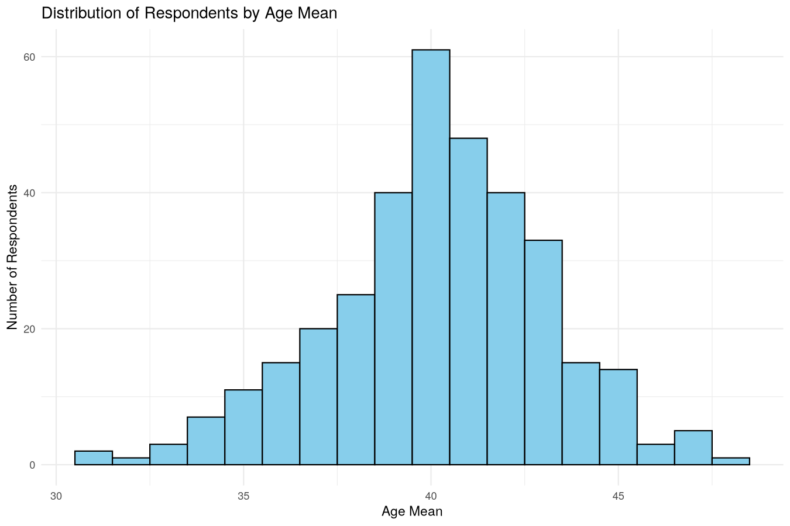
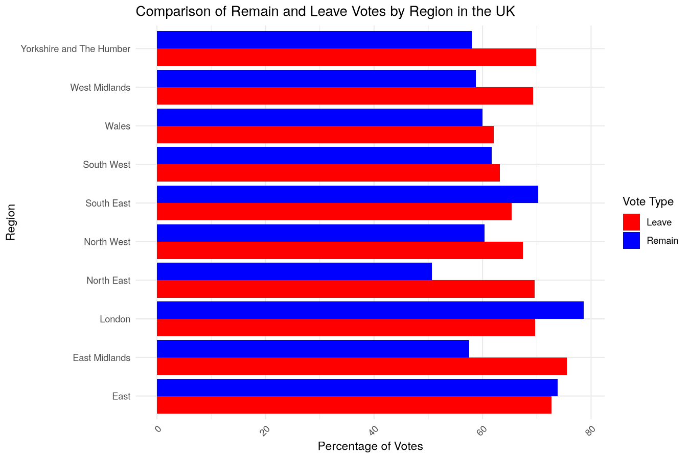
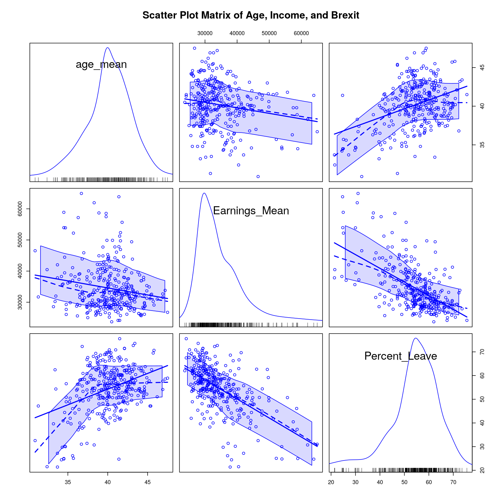
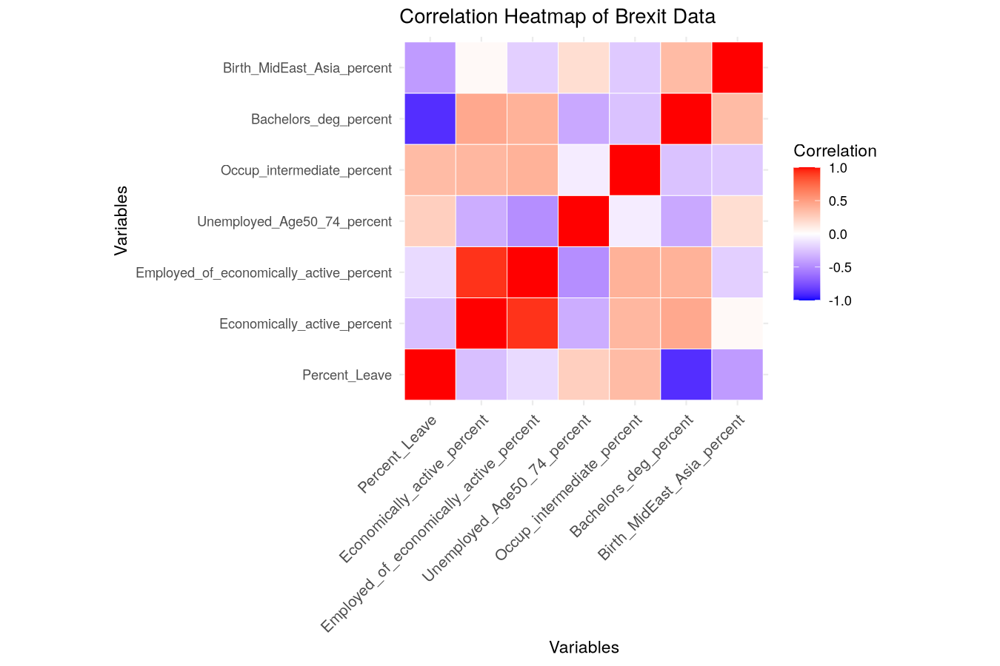

# Brexit Referendum Analysis


A data-driven analysis of the 2016 UK EU Referendum, combining official
referendum results with Census-based socio-economic indicators to explore
who voted Leave and why.

- [Analysis report](#analysis-report) &middot; [Highlights](#highlights) &middot; [Getting started](#getting-started) &middot; [Outputs](#outputs) &middot; [Repository layout](#repository-layout)

---

# Analysis report

## Introduction

This report analyses the results of the 2016 EU Referendum at UK local
authority level, combining voting outcomes with socio-economic
indicators such as age, earnings, employment, education, and
immigration.

## Data Loading and Cleaning

``` r
data <- read.csv("brexit_data.csv")

# Remove duplicate entries
data <- unique(data)

# Filter out non-finite values in the 'Age_Mean' column
data <- data[is.finite(data$age_mean), ]

cat("Rows after cleaning:", nrow(data))
```

    ## Rows after cleaning: 344

``` r
cat("\nRegions covered:", length(unique(data$Region)))
```

    ## 
    ## Regions covered: 10

### Overview of the Data

``` r
knitr::kable(head(data[, c("Area", "Region", "Percent_Remain", "Percent_Leave", "Percent_Turnout", "age_mean")], 10),
             caption = "First 10 rows of the dataset")
```

|  | Area | Region | Percent_Remain | Percent_Leave | Percent_Turnout | age_mean |
|:---|:---|:---|---:|---:|---:|---:|
| 3 | Adur | South East | 45.43232 | 54.56768 | 76.40 | 43.0 |
| 4 | Allerdale | North West | 41.35293 | 58.64707 | 72.92 | 43.1 |
| 5 | Amber Valley | East Midlands | 39.71688 | 60.28312 | 76.34 | 41.8 |
| 8 | Arun | South East | 37.52154 | 62.47846 | 77.86 | 45.5 |
| 9 | Ashfield | East Midlands | 30.16338 | 69.83662 | 72.83 | 40.0 |
| 10 | Ashford | South East | 40.57261 | 59.42739 | 77.14 | 39.6 |
| 11 | Aylesbury Vale | South East | 49.49501 | 50.50499 | 78.46 | 39.1 |
| 12 | Babergh | East | 45.81478 | 54.18522 | 78.26 | 43.1 |
| 13 | Barking and Dagenham | London | 37.56091 | 62.43909 | 63.85 | 33.4 |
| 14 | Barnet | London | 62.22948 | 37.77052 | 72.14 | 36.8 |

First 10 rows of the dataset

## Distribution of Respondents by Age

``` r
ggplot(data, aes(x=age_mean)) +
  geom_histogram(binwidth = 1, fill="skyblue", color="black") +
  labs(title="Distribution of Respondents by Age Mean", x="Age Mean", y="Number of Respondents") +
  theme_minimal()
```

<!-- -->

The age distribution is roughly bell-shaped and centred in the early
40s, reflecting the age profile of UK local authorities.

## Remain vs Leave by Region

``` r
brexit_data_long <- pivot_longer(data, cols = c(Percent_Remain, Percent_Leave),
                                 names_to = "Vote_Type", values_to = "Percentage")

ggplot(brexit_data_long, aes(x = reorder(Region, Percentage), y = Percentage, fill = Vote_Type)) +
  geom_bar(stat = "identity", position = "dodge") +
  labs(title = "Comparison of Remain and Leave Votes by Region in the UK",
       x = "Region", y = "Percentage of Votes", fill = "Vote Type") +
  theme_minimal() +
  theme(axis.text.x = element_text(angle = 45, hjust = 1)) +
  scale_fill_manual(values = c("red", "blue"), labels = c("Leave", "Remain")) +
  guides(fill = guide_legend(title = "Vote Type")) +
  coord_flip()
```

<!-- -->

### Average Vote by Region

``` r
region_summary <- aggregate(cbind(Percent_Remain, Percent_Leave) ~ Region,
                            data = data, FUN = mean)
region_summary <- region_summary[order(region_summary$Percent_Leave, decreasing = TRUE), ]
knitr::kable(region_summary,
             caption = "Average Remain and Leave percentages by region (sorted by Leave)",
             digits = 1)
```

|     | Region                   | Percent_Remain | Percent_Leave |
|:----|:-------------------------|---------------:|--------------:|
| 9   | West Midlands            |           39.7 |          60.3 |
| 2   | East Midlands            |           40.4 |          59.6 |
| 4   | North East               |           40.5 |          59.5 |
| 10  | Yorkshire and The Humber |           41.4 |          58.6 |
| 1   | East                     |           43.2 |          56.8 |
| 5   | North West               |           44.1 |          55.9 |
| 7   | South West               |           46.3 |          53.7 |
| 8   | Wales                    |           46.3 |          53.7 |
| 6   | South East               |           47.8 |          52.2 |
| 3   | London                   |           60.9 |          39.1 |

Average Remain and Leave percentages by region (sorted by Leave)

## Relationship between Age, Income, and Brexit

``` r
scatterplotMatrix(~ age_mean + Earnings_Mean + Percent_Leave, data = data,
                  main = "Scatter Plot Matrix of Age, Income, and Brexit")
```

<!-- -->

The scatter plot matrix shows the pairwise relationships between mean
age, mean earnings, and the Leave vote share across local authorities.

## Correlation Heatmap of Socio-Economic Factors

``` r
heatmap_data <- data[, c("Percent_Leave",
                                "Economically_active_percent",
                                "Employed_of_economically_active_percent",
                                "Unemployed_Age50_74_percent",
                                "Occup_intermediate_percent",
                                "Bachelors_deg_percent",
                                "Birth_MidEast_Asia_percent")]

correlation_matrix <- cor(heatmap_data, use = "pairwise.complete.obs")
melted_correlation <- melt(correlation_matrix)

ggplot(melted_correlation, aes(Var1, Var2, fill = value)) +
  geom_tile(color = "white") +
  scale_fill_gradient2(low = "blue", high = "red", mid = "white",
                       midpoint = 0, limit = c(-1,1), space = "Lab",
                       name="Correlation") +
  theme_minimal() +
  theme(axis.text.x = element_text(angle = 45, vjust = 1, size = 10, hjust = 1)) +
  coord_fixed() +
  labs(title = "Correlation Heatmap of Brexit Data", x = "Variables", y = "Variables")
```

<!-- -->

### Correlation Table

``` r
knitr::kable(round(correlation_matrix, 2),
             caption = "Correlation matrix of socio-economic factors and Leave vote")
```

|  | Percent_Leave | Economically_active_percent | Employed_of_economically_active_percent | Unemployed_Age50_74_percent | Occup_intermediate_percent | Bachelors_deg_percent | Birth_MidEast_Asia_percent |
|:---|---:|---:|---:|---:|---:|---:|---:|
| Percent_Leave | 1.00 | -0.28 | -0.16 | 0.25 | 0.35 | -0.89 | -0.43 |
| Economically_active_percent | -0.28 | 1.00 | 0.93 | -0.35 | 0.38 | 0.45 | 0.03 |
| Employed_of_economically_active_percent | -0.16 | 0.93 | 1.00 | -0.49 | 0.40 | 0.40 | -0.20 |
| Unemployed_Age50_74_percent | 0.25 | -0.35 | -0.49 | 1.00 | -0.08 | -0.37 | 0.17 |
| Occup_intermediate_percent | 0.35 | 0.38 | 0.40 | -0.08 | 1.00 | -0.26 | -0.23 |
| Bachelors_deg_percent | -0.89 | 0.45 | 0.40 | -0.37 | -0.26 | 1.00 | 0.35 |
| Birth_MidEast_Asia_percent | -0.43 | 0.03 | -0.20 | 0.17 | -0.23 | 0.35 | 1.00 |

Correlation matrix of socio-economic factors and Leave vote

## Conclusion

The visualisations reveal a clear regional divide in the Leave vote and
strong associations between voting behaviour and socio-economic
characteristics, consistent with the pattern observed nationally in
2016.

---

## Highlights

- 344 UK local authorities analysed
- Leave avg 54.4% | Remain avg 45.6% | Turnout avg 74.2%
- Education is the strongest predictor of the Leave vote (r = −0.89)
- Full analysis report below, fully reproducible in Docker

## Getting started

```bash
# Build the image
docker build -t brexit-analysis .

# Generate the 4 PNG plots into ./plots
docker run --rm -v "$(pwd)/plots:/app/plots" brexit-analysis
```

## Outputs

| File | Description |
|------|-------------|
| `plots/1_age_distribution.png` | Histogram of respondent age |
| `plots/2_remain_leave_by_region.png` | Remain vs Leave by region |
| `plots/3_age_income_brexit_matrix.png` | Scatter plot matrix of age, income, Brexit |
| `plots/4_correlation_heatmap.png` | Correlation heatmap of socio-economic factors |
| `report_files/figure-gfm/` | Plot images used by this README |

## Repository layout

```
analysis.r             Analysis script (reads brexit_data.csv, writes plots/)
Dockerfile             Debian r-base + ggplot2/tidyr/reshape2/car + pandoc
brexit_data.csv        Source data (copied into the image by the Docker build)
case-study.html        Publishable case study (TinyMCE-ready body HTML)
report_files/          Plot images used by this README
AGENTS.md              Guide for AI agents working in this repo
```

## Documentation

See [AGENTS.md](AGENTS.md) for a detailed agent-oriented guide to the
codebase, data quirks, and known gotchas.
